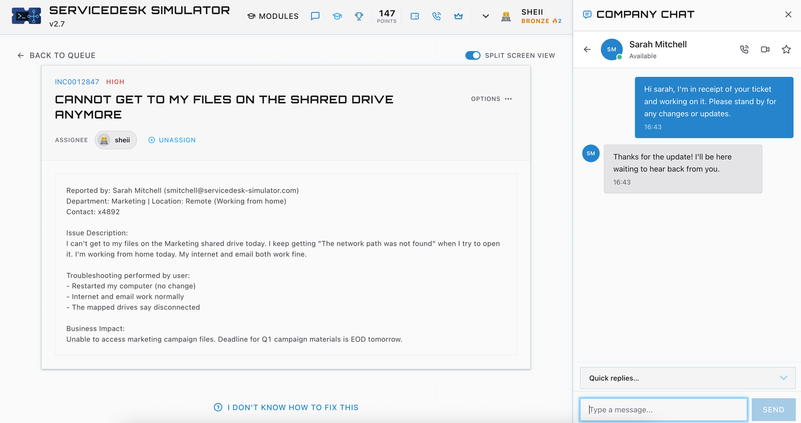
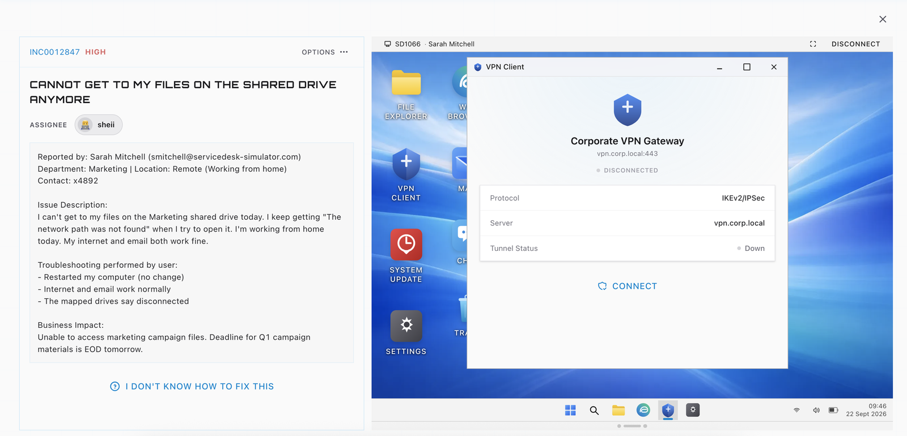
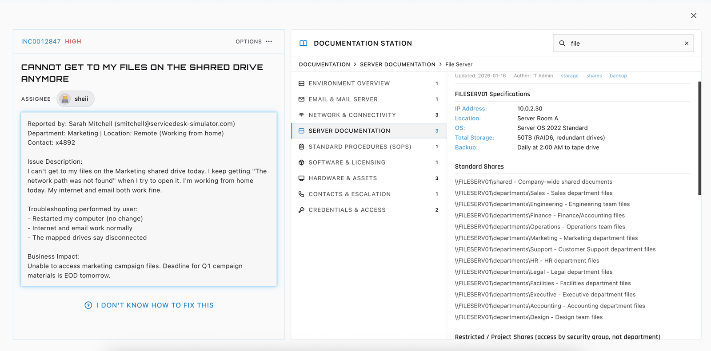
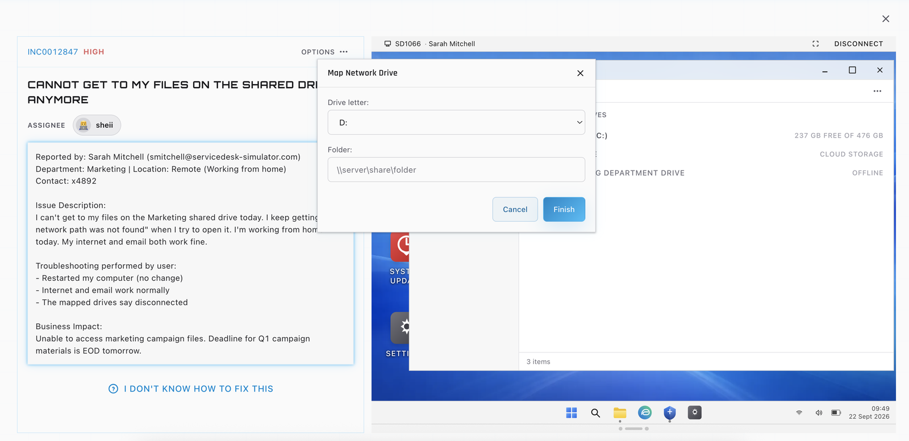
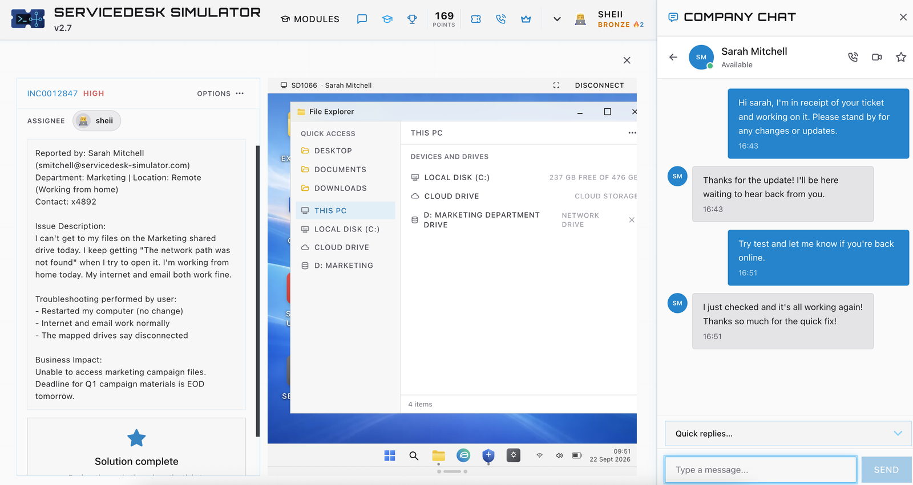

# Case 01: Marketing user cannot reach the shared drive from home

| | |
|---|---|
| Ticket | INC0012847 |
| Priority | High |
| Area | Remote access and file shares |
| Reporter | Marketing, working from home |
| Result | Resolved, user confirmed |

## The ticket

A Marketing user working from home could not open her department's shared drive. She kept getting "The network path was not found". Her internet and email worked normally, the mapped drives showed as disconnected, and restarting her computer had changed nothing. She had a Q1 campaign deadline at the end of the next day, which is why the ticket was High priority.

## How I read it

Three details shaped my first move.

Internet and email worked, so her home connection and her computer were not the problem. Only internal resources were failing, which pointed at the route to the file server. And she was remote, so that route depends on the VPN.

"The network path was not found" tells me the computer could not reach or resolve the server. It is not a permissions message. That ruled out an access rights fix and sent me to connectivity first.

## What I did

1. I acknowledged the ticket straight away in Company Chat, telling her I had it and would update her.
2. I connected to her workstation over remote desktop.
3. In File Explorer, the Marketing drive was listed as a network drive but showed as disconnected.
4. In the VPN client, the Corporate VPN Gateway showed as disconnected with the tunnel down. That fits the symptoms of a remote user who cannot reach an internal file server.

   

5. I opened the File Server page in the documentation station to confirm the server name and the correct Marketing share path instead of guessing. The server is FILESERV01 and the department shares sit under `\\FILESERV01\departments`.

   

6. I remapped the Marketing drive to `\\FILESERV01\departments\Marketing` using Map Network Drive.

   

7. I asked her to test and let me know when she was back online.
8. She confirmed everything was working, and the platform marked the solution complete.

   

## Outcome

The Marketing drive was available again and she confirmed it herself. From my first acknowledgement to her confirmation took about eight minutes in the simulator.

## Communication

* I acknowledged the ticket immediately and set expectations.
* I asked her to test the result instead of assuming it worked.
* I closed the ticket only after she confirmed.

## What I would do differently

* Write the cause in the ticket notes in plain words, including the state of the VPN before and after, so the next person sees why it happened and not only that it was fixed.
* Tell the user to check the VPN first when she works from home, and look into whether the client can be set to connect automatically.
* Add the remapping steps to the knowledge base so the next occurrence is a two minute fix.

## Quick runbook: remote user cannot reach a shared drive

1. Confirm internet and email work, to rule out a general outage.
2. Confirm whether the user is remote and whether the VPN is connected.
3. Check the state of the mapped drive in File Explorer.
4. Find the correct share path in the documentation.
5. Reconnect the VPN if it is down, then remap the drive to the documented path.
6. Ask the user to open a file from the share.
7. Record the cause and the fix in the ticket.
