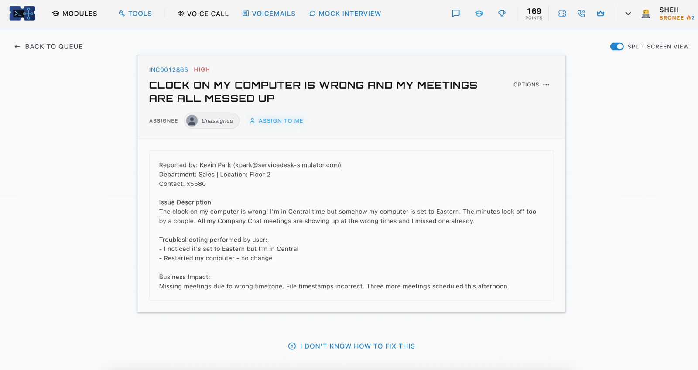
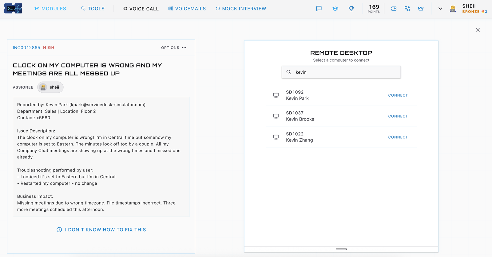
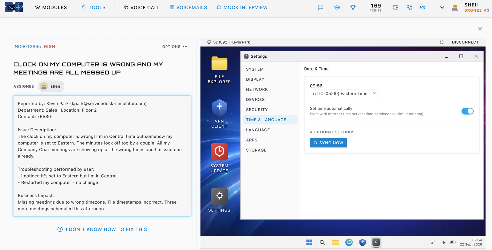
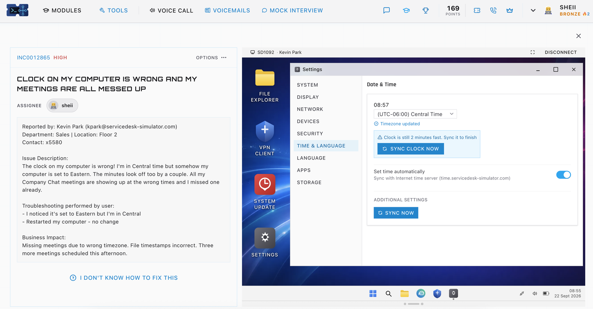
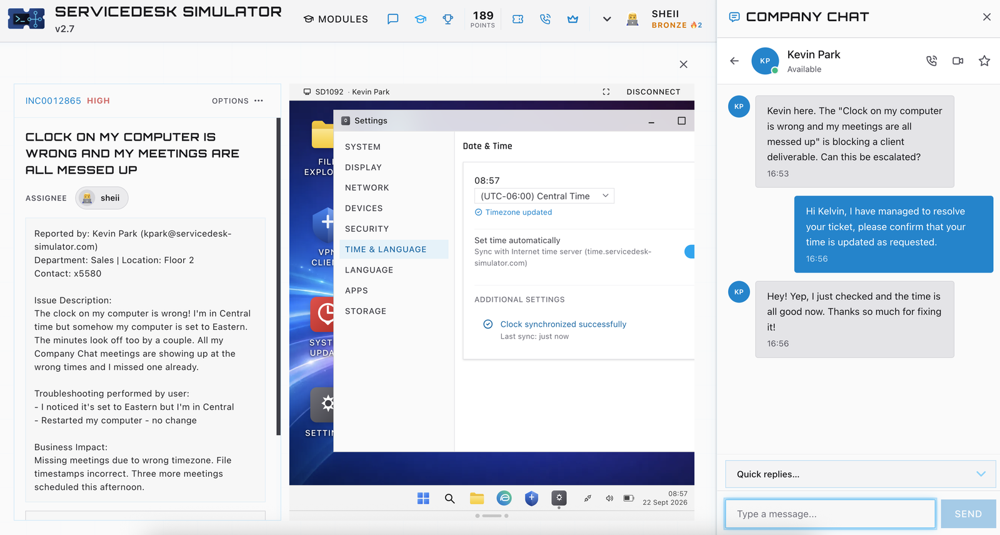

# Case 02: Wrong time zone and a drifting clock

| | |
|---|---|
| Ticket | INC0012865 |
| Priority | High |
| Area | Desktop settings |
| Reporter | Sales, Floor 2 |
| Result | Resolved, user confirmed |

## The ticket

A Sales user reported that his computer was set to Eastern time when he works in Central. The minutes also looked off by a couple. His Company Chat meetings were showing at the wrong times and he had already missed one, with three more scheduled that afternoon. File timestamps were wrong as well. Restarting had not helped.

## How I read it

The ticket described two separate symptoms. The hours were wrong, which is a time zone problem. The minutes were off, which is a clock accuracy problem. Changing the time zone would not fix minutes, so I planned two checks and not one.

## What I did

1. I assigned the ticket to myself from the queue.
2. I searched the remote desktop list for "kevin". It returned three machines, belonging to Kevin Park, Kevin Brooks and Kevin Zhang. I matched the surname on the ticket before connecting, so I only touched the right person's computer.

   

3. In Settings, under Time and Language, the time zone was set to Eastern (UTC-05:00). Automatic time was already switched on.

   

4. I changed the time zone to Central (UTC-06:00). Settings confirmed the update and also warned that the clock was still two minutes fast.

   

5. I used Sync Clock Now, and Settings reported that the clock synchronised successfully.
6. While I was working, the user messaged to say the issue was blocking a client deliverable and asked whether it could be escalated. I replied that I had resolved it and asked him to confirm. He checked and confirmed the time was correct.

   

## Outcome

The time zone and the clock were both corrected, and the user confirmed. His escalation request and his confirmation were three minutes apart, so the ticket did not need to be escalated.

## What I took from it

**One complaint, two causes.** If I had stopped after changing the time zone, he would still have been two minutes out. I checked the result after the change and not only the setting I changed.

**Several users share a first name.** Searching "kevin" returned three people. Matching the full name to the ticket before connecting is a small habit that prevents a large mistake.

## What I would do differently

* Ask why the clock had drifted when automatic time was already on. In a real environment I would check that the time server is reachable and whether other computers built the same way carry the same wrong time zone.
* Ask the user to look at his next few meeting invitations, since any created while the zone was wrong may need correcting.
* Reread my chat replies before sending. In one reply I misspelled the user's name, which is a small slip but one that costs trust on a real desk.

## Quick runbook: wrong time or time zone

1. Confirm the right user and the right machine.
2. Compare the time zone setting with where the user actually works.
3. Correct the time zone.
4. Check for clock drift after the change and sync the clock if needed.
5. Confirm automatic time is on and the time source is reachable.
6. Ask the user to confirm the time and check upcoming meetings.
7. Record the cause and the fix in the ticket.
